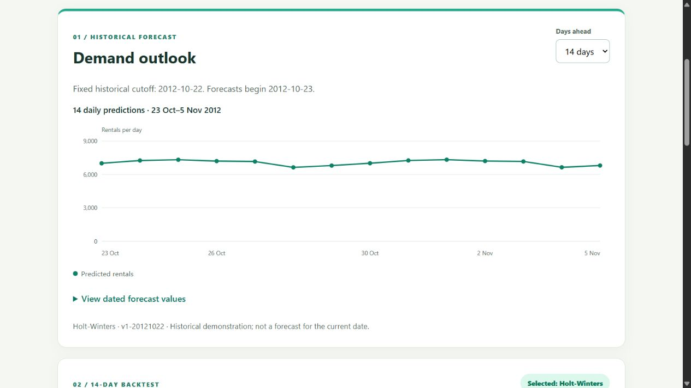
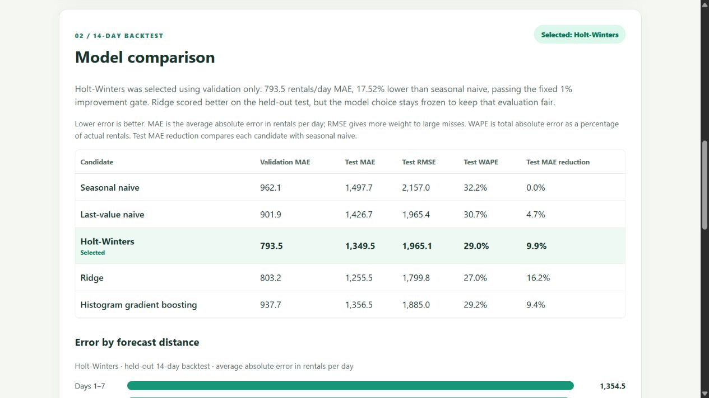
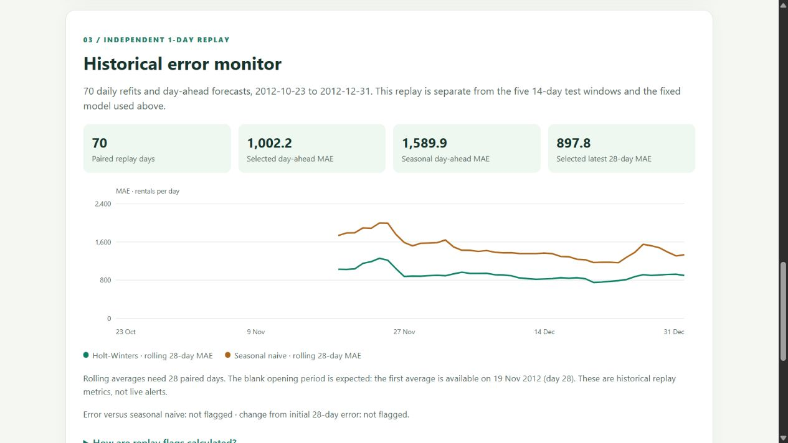
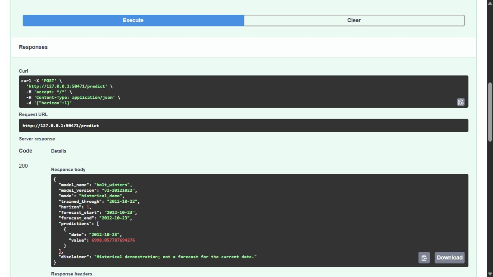
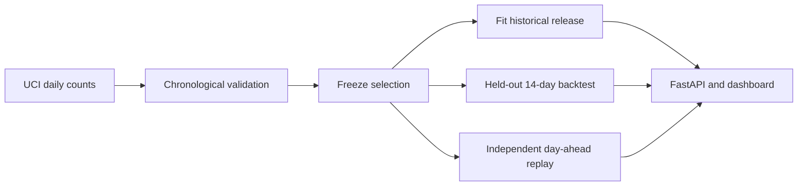

# ForecastOps

Historical bike-demand forecasting with chronological backtesting, validation-only model selection, and a versioned FastAPI service.

**Docker-verified local portfolio demo.** The included model forecasts from **2012-10-22**, using UCI Bike Sharing data from 2011–2012. No hosted service or current-day demand forecast is claimed. Run it locally without training.

[Run with Docker](#run-with-docker) · [Results](#results) · [API](#api) · [Verification](docs/verification.md)



## What it demonstrates

- Five fixed forecasting candidates compared on the same chronological windows, with future targets hidden while each forecast is issued.
- A validation-only selection rule with a 1% improvement gate over seasonal naive; the held-out test never changes the choice.
- A persisted model serving 1–14 dated forecasts, strict input validation, readiness checks, and interactive API documentation.
- A responsive dashboard with dated forecast values, model comparison, horizon errors, and a separate SQLite monitoring replay.
- Isolated verification that preserves frozen results, plus Docker startup, graceful restart, and fresh-container recovery.

## Run with Docker

Requires Docker with a running Linux engine. From a cloned repository:

```sh
git clone https://github.com/saidarshan20/ForecastOps.git
cd ForecastOps
docker build -t forecastops:local .
docker run --rm -p 127.0.0.1:10000:10000 -e PORT=10000 forecastops:local
```

Open the [dashboard](http://127.0.0.1:10000/), [API docs](http://127.0.0.1:10000/docs), or [readiness endpoint](http://127.0.0.1:10000/health). The image includes the fitted model, reports, and SQLite seed. It does **no training at startup** and runs as a non-root user.

The runtime database is copied from the seed only when absent. Restarting the same container retains it; a new container restores the historical snapshot. The demo has no incoming live data feed or permanent monitoring service.

## Results

The 731 daily observations are split into **591 initial training days**, **70 validation days**, and **70 held-out test days**:

| Partition | Dates | Evaluation |
|---|---|---|
| Initial training | 2011-01-01–2012-08-13 | History available at the first validation origin |
| Validation | 2012-08-14–2012-10-22 | Five nonoverlapping 14-day windows; selection only |
| Test | 2012-10-23–2012-12-31 | Five nonoverlapping 14-day windows; frozen choice |

At each origin, models fit on past actuals, issue all 14 predictions, and only then reveal that window's targets for scoring. History expands between windows. The [experiment contract](docs/experiment_contract.md) defines the fixed candidates, parameters, splits, and selection rule.

| Candidate | Validation MAE | Test MAE | Test RMSE | Test WAPE | Test MAE reduction vs seasonal |
|---|---:|---:|---:|---:|---:|
| Seasonal naive | 962.06 | 1497.66 | 2156.97 | 32.22% | reference |
| Last-value naive | 901.89 | 1426.69 | 1965.37 | 30.70% | 4.74% |
| **Holt-Winters — selected** | **793.46** | **1349.46** | 1965.10 | 29.04% | 9.90% |
| Ridge | 803.19 | 1255.47 | 1799.82 | 27.01% | 16.17% |
| Histogram gradient boosting | 937.72 | 1356.47 | 1885.01 | 29.19% | 9.43% |

**Holt-Winters won validation**, reducing seasonal-naive MAE by **17.52%**, above the fixed 1% gate. It reduced test MAE by **9.90%**. Ridge had lower test MAE, but selecting it afterward would use held-out results for model selection, so the original choice remains frozen. These are error reductions, not accuracy percentages.

For selected Holt-Winters, test MAE was 1354.55 on days 1–7 and 1344.37 on days 8–14. Exact results: [comparison](reports/model_comparison.csv), [frozen selection](reports/selection.json), and [horizon errors](reports/horizon_errors.csv).

<details>
<summary>View the model comparison screenshot</summary>



</details>

## Monitoring is a separate historical replay

The **70-day, one-step-ahead replay** refits the frozen model type daily using only previous actuals. It measures a different policy from both the 14-day backtest and the API's fixed artifact:

| Measure | Holt-Winters | Seasonal naive |
|---|---:|---:|
| Replay day-ahead MAE | 1002.21 | 1589.93 |
| Latest rolling 28-day MAE | 897.78 | 1330.61 |

SQLite holds 140 issued forecasts and 70 actuals without duplication. Rolling MAE first appears on **19 November 2012**, after 28 paired days. Flags describe historical error changes; they do not trigger live alerts, model reselection, or serving-time retraining.



## API

| Route | Purpose |
|---|---|
| `GET /health` | Validate release, inference, replay, reports, and required dashboard assets |
| `GET /model` | Model version, cutoff, provenance, and selection rationale |
| `POST /predict` | Return 1–14 consecutive historical predictions |
| `GET /monitoring` | SQLite-backed historical replay metrics |
| `GET /comparison` | Validation/test comparison for five candidates |
| `GET /horizons` | Per-step and grouped horizon errors |
| `/docs` | Interactive Swagger documentation |
| `/` | Dashboard |

PowerShell example for the Docker demo:

```powershell
Invoke-RestMethod -Uri http://127.0.0.1:10000/predict -Method Post -ContentType 'application/json' -Body '{"horizon":1}'
```

A real one-day response from the included artifact:

```json
{
  "model_name": "holt_winters",
  "model_version": "v1-20121022",
  "mode": "historical_demo",
  "trained_through": "2012-10-22",
  "horizon": 1,
  "forecast_start": "2012-10-23",
  "forecast_end": "2012-10-23",
  "predictions": [{"date": "2012-10-23", "value": 6998.057787694276}],
  "disclaimer": "Historical demonstration; not a forecast for the current date."
}
```

Horizon defaults to 14. Its dates always run from **2012-10-23 through 2012-11-05**, regardless of today's date. Invalid types, ranges, and extra fields return HTTP 422. Missing or corrupt required evidence causes readiness to return 503. The dashboard formats values for readability; API forecasts retain full precision.

<details>
<summary>View a real Swagger prediction</summary>



</details>

## Data and method

Source: [UCI Bike Sharing Dataset](https://archive.ics.uci.edu/dataset/275/bike+sharing+dataset), Hadi Fanaee-T, DOI [10.24432/C5W894](https://doi.org/10.24432/C5W894), [CC BY 4.0](https://creativecommons.org/licenses/by/4.0/). Only `dteday` and `cnt` enter modeling. Original `day.csv` SHA-256: `a6bcf826782d3c0fbfdcbeead17cd0884185a0dafe8ff10cd48a874ee7ba18be`. See [attribution](docs/data_attribution.md) and [data manifest](reports/data_manifest.json).

Candidates: seasonal naive (lag 7), last-value naive, additive damped weekly Holt-Winters, scaled Ridge, and histogram gradient boosting. Regression features use lags 1/7/14/28, shifted rolling means 7/28, weekday, and month. Forecasts recurse on previous predictions inside each issued window. No future weather or unrevealed target enters inference. Negative forecasts are clipped to zero without rounding.



## Develop and verify

The measured local environment and Docker image use **Python 3.13**. Windows PowerShell setup:

```powershell
py -3.13 -m venv .venv
.\.venv\Scripts\python.exe -m pip install -r requirements.txt
.\.venv\Scripts\python.exe -m pip install -e . --no-deps
.\.venv\Scripts\python.exe -m pytest -q
.\.venv\Scripts\python.exe -m uvicorn forecastops.api.main:app --host 127.0.0.1 --port 8000
```

The direct Python server uses port 8000; the Docker example uses port 10000. `.env.example` documents configuration but is not loaded automatically. On macOS/Linux, use `python3.13 -m venv .venv` and `.venv/bin/python` for the equivalent commands.

Verification completed on **2026-11-05**:

- **45 automated tests passed**, including leakage invariance, strict API contracts, missing/corrupt fixtures, replay idempotency, and no fitting during serving.
- Isolated experiment reproduction matched the frozen evidence without replacing it.
- Docker Linux/amd64 build passed with all 38 pinned dependencies. Default/custom ports, non-root permissions, graceful restart, and fresh-container recovery passed.
- Linux inference matched the saved local model; restart preserved database bytes. Browser checks confirmed forecasts and Swagger execution. Responsive widths 320/390/768/1280 had no page-level overflow.

Optional verification commands, each using a **new** output directory:

```powershell
.\.venv\Scripts\python.exe -m scripts.smoke_server --output-dir output/verification/new-http-run --port 18765
.\.venv\Scripts\python.exe -m scripts.verify_docker --image forecastops:local --output-dir output/verification/new-docker-run
.\.venv\Scripts\python.exe -m scripts.verify_experiment --output-dir output/verification/new-experiment-run
```

The experiment command performs isolated offline refits; it is **not needed to run the demo**. Original validation byte hashes remain strict; numerical reproduction excludes variable timing/timestamp fields and uses `rtol=1e-10`, `atol=1e-7`. Raw verification output and mutable runtime data stay local. See [verification and troubleshooting](docs/verification.md).

## Layout and limitations

- `forecastops/`: data checks, features, candidates, evaluation, monitoring, and API.
- `web/`: responsive HTML/CSS/JavaScript dashboard.
- `scripts/`, `tests/`: isolated verification and behavior checks.
- `artifacts/`: fixed serving release and monitoring seed; `reports/`: measured results and provenance.
- `docs/`: experiment contract, attribution, verification guide, and screenshots.

This small historical dataset does not establish present-day forecasting performance. The API serves a fixed 2012 artifact; monitoring is an offline daily-refit replay. No live feed, authentication, automated retraining, production service objective, or public deployment is included. Screenshots show the local Docker demo, captured on 2026-11-05.
