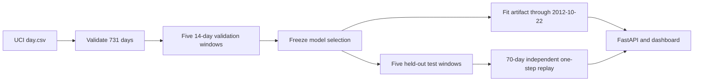

# ForecastOps

A historical bike-rental demand forecasting demo with leakage-aware backtesting, five fixed candidates, validation-only selection, a versioned FastAPI artifact, and a separate day-ahead monitoring replay. **All dates refer to 2011–2012 historical data. This is not a live demand forecast.**

[Dashboard screenshot](output/playwright/dashboard-full.png) · [API docs screenshot](output/playwright/api-docs.png) · [Real prediction response](output/playwright/prediction-response.png) · [Beginner-to-advanced walkthrough](WALKTHROUGH.md) · [Deployment guide](docs/DEPLOYMENT.md)

## Results

The 731 daily observations are split chronologically: 591 initial training days (2011-01-01–2012-08-13), 70 validation days (2012-08-14–2012-10-22), and 70 held-out test days (2012-10-23–2012-12-31). Five nonoverlapping 14-day windows are scored in each evaluation period. Each window is forecast in full before its actuals are revealed. [The experiment contract](docs/experiment_contract.md) was fixed before test evaluation.

| Candidate | Validation MAE | Test MAE | Test RMSE | Test WAPE | Test MAE gain vs seasonal |
|---|---:|---:|---:|---:|---:|
| Seasonal naive | 962.06 | 1497.66 | 2156.97 | 32.22% | reference |
| Last-value naive | 901.89 | 1426.69 | 1965.37 | 30.70% | 4.74% |
| **Holt-Winters — selected** | **793.46** | **1349.46** | 1965.10 | 29.04% | 9.90% |
| Ridge | 803.19 | 1255.47 | 1799.82 | 27.01% | 16.17% |
| Histogram gradient boosting | 937.72 | 1356.47 | 1885.01 | 29.19% | 9.43% |

Holt-Winters won on validation, improving seasonal-naive MAE by 17.52%, above the fixed 1% gate. It also beat seasonal naive on test. Ridge scored better on test, but choosing it after seeing test results would invalidate the selection protocol. For selected Holt-Winters, test MAE was 1354.55 on steps 1–7 and 1344.37 on steps 8–14. Exact outputs are in [`reports/model_comparison.csv`](reports/model_comparison.csv), [`reports/selection.json`](reports/selection.json), and [`reports/horizon_errors.csv`](reports/horizon_errors.csv).

The independent 70-day monitoring replay refits the frozen model type daily using only previous actuals and predicts one day ahead. Its Holt-Winters MAE is 1002.21, versus 1589.93 for seasonal naive. Latest rolling 28-day MAEs are 897.78 and 1330.61. These numbers measure a different task from the 14-day backtest and are never used to change selection. The replay is an offline simulation, not hosted automatic retraining or a live alert.

## Data and method

Data: [UCI Bike Sharing Dataset](https://archive.ics.uci.edu/dataset/275/bike+sharing+dataset), Hadi Fanaee-T, DOI [10.24432/C5W894](https://doi.org/10.24432/C5W894), [CC BY 4.0](https://creativecommons.org/licenses/by/4.0/). Only `dteday` and `cnt` are used. Original `day.csv` SHA-256: `a6bcf826782d3c0fbfdcbeead17cd0884185a0dafe8ff10cd48a874ee7ba18be`. See [data attribution](docs/data_attribution.md) and [data manifest](reports/data_manifest.json).

The five fixed candidates are seasonal naive, last-value naive, additive damped Holt-Winters with weekly seasonality, scaled Ridge, and histogram gradient boosting. Regression features use lags 1/7/14/28, shifted rolling means 7/28, weekday, and month. Regression forecasts recurse on their own prior predictions inside a window. No observed future weather or unrevealed target enters inference. Forecasts are clipped to zero without rounding. Candidate parameters and exact split/window rules are in the contract.



## Run locally

The available development runtime was Python **3.13**; the Dockerfile uses 3.13 to match the pinned release. On Windows PowerShell:

```powershell
py -3.13 -m venv .venv
.\.venv\Scripts\python.exe -m pip install -r requirements.txt
.\.venv\Scripts\python.exe -m pip install -e . --no-deps
.\.venv\Scripts\python.exe -m pytest -q
.\.venv\Scripts\python.exe -m scripts.prepare_data
.\.venv\Scripts\python.exe -m scripts.run_validation
.\.venv\Scripts\python.exe -m scripts.select_and_test
.\.venv\Scripts\python.exe -m scripts.build_serving_artifact
.\.venv\Scripts\python.exe -m scripts.replay_monitoring
.\.venv\Scripts\python.exe -m pytest -q
.\.venv\Scripts\python.exe -m uvicorn forecastops.api.main:app --host 127.0.0.1 --port 8000
```

The supplied UCI file is at `datasets/bike+sharing+dataset/day.csv`. `prepare_data` validates it and writes a two-column processed series. Running `select_and_test` again verifies the existing frozen selection against validation checksums and refuses to silently change it.

API: `GET /health`, `GET /model`, `POST /predict`, `GET /monitoring`, `GET /comparison`, `GET /horizons`, `/docs`, and dashboard `/`. Example:

```powershell
Invoke-RestMethod -Uri http://127.0.0.1:8000/predict -Method Post -ContentType 'application/json' -Body '{"horizon":14}'
```

The response always starts on **2012-10-23**, from the persisted model trained through **2012-10-22**. Horizon is an integer from 1 to 14. The artifact contains no test-period actuals.

## Docker and deployment

The image installs pinned dependencies and copies the already built model, reports, and SQLite seed. It does no fitting or backtesting at startup. The local runtime database is copied from the seed only when missing.

```powershell
docker build -t forecastops:local .
docker run --rm -p 10000:10000 -e PORT=10000 forecastops:local
```

Docker was unavailable on the development machine, so these commands and container readiness are **not yet verified**. The GitHub remote is `https://github.com/saidarshan20/ForecastOps.git`; a Render service and live URL are still pending. Render can build this Dockerfile remotely. Follow the [step-by-step deployment guide](docs/DEPLOYMENT.md) to create the web service and verify `/health`, `/predict`, `/monitoring`, `/docs`, and `/`. Render filesystem resets can discard mutable runtime SQLite; the bundled seed restores the historical snapshot.

## Layout and limits

- `forecastops/data`, `features`, `models`, `evaluation`, `monitoring`, `api`: package modules.
- `scripts`: offline reproducible pipeline stages.
- `artifacts/release`: fitted historical model and manifest; `artifacts/monitoring_seed.sqlite`: replay snapshot.
- `reports`: predictions, metrics, selection record, provenance, and monitoring summary.
- `web`: dashboard; `tests`: behavior checks; [task tracker](TASK_TRACKER.md): progress and resume point.

This small 2011–2012 dataset does not establish current performance. The fixed API artifact and daily refit replay represent different operating policies. No automatic data feed, authentication, live retraining, or production service objective is included.
