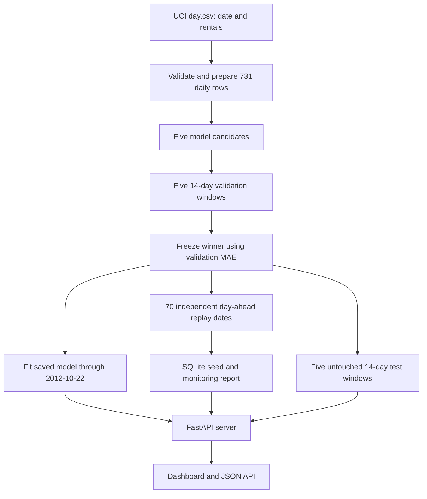
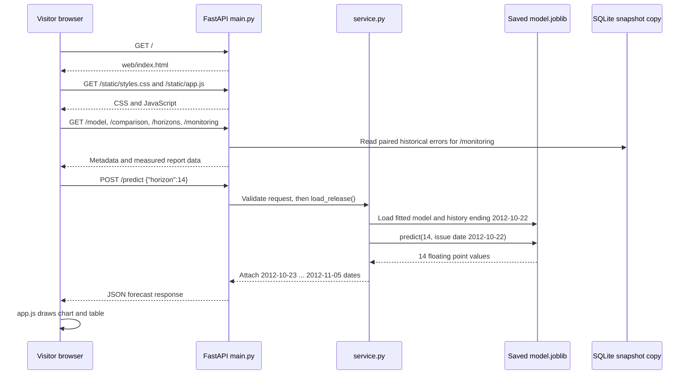
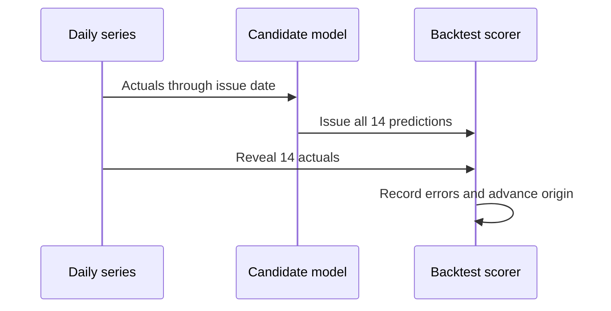

# ForecastOps walkthrough

> **Start here if this is your first ML application.** Read sections 1–5 in order. The later sections trace the code, explain the experiment, and give interview questions. Everything in this guide describes the actual repository and its measured outputs.

## 1. The project in plain English

Imagine you run a bike rental service. You want a rough answer to: **How many rentals might happen on each of the next 1–14 days?** ForecastOps answers that question for a saved moment in the past. Its model knows rental counts through **2012-10-22** and returns predictions starting **2012-10-23**. The user chooses only the number of days. The website shows the forecast, how several methods performed in historical tests, and a separate record of day-ahead errors.

It has two big jobs:

| Job | When it happens | What it produces |
|---|---|---|
| **Offline experiment** | Developer runs `python -m scripts...` | Validated data, comparison reports, frozen winner, saved model, monitoring snapshot |
| **Online serving** | Visitor opens the site or calls the API | A fast response from the already saved model and reports |

The visitor does **not** send a chat message. This is not an LLM or chatbot. The visitor sends a small HTTP request such as `{"horizon":14}`. The server returns JSON with dates and numeric demand estimates. It does not train a model while responding.

**Why historical?** The only supplied target series covers 2011–2012. Showing a prediction for 2026 from it would imply a current data feed that does not exist. This is a portfolio demonstration of sound forecasting workflow and API engineering.

## 2. The whole system on one page



Think of the **offline experiment** as preparing a finished exam paper and answer key. Think of the **API** as handing out a copy of the already prepared answer to each visitor. The API reads prepared artifacts; it does not repeat the experiment.

Here is where each important output lives:

| Output | File | Why it matters |
|---|---|---|
| Clean daily series | `data/processed/daily_rentals.csv` | Only date and rental count, after strict checks |
| Selection decision | `reports/selection.json` | Proof that the winner was chosen using validation only |
| Comparison | `reports/model_comparison.csv` | Actual validation and test results for all five candidates |
| Saved release | `artifacts/release/model.joblib` and `manifest.json` | The model and cutoff the API serves |
| Replay snapshot | `artifacts/monitoring_seed.sqlite` | 70 days of issued one-day forecasts and revealed actuals |
| Human view | `web/index.html`, `app.js`, `styles.css` | Dashboard loaded in the browser |

## 3. Exactly what happens when someone visits the site

The complete browser route is below. Reading this once helps separate **browser JavaScript**, **server Python**, and the **saved model**.



Step by step, with the real functions:

1. A browser requests `/`. `dashboard()` in [`forecastops/api/main.py`](forecastops/api/main.py) sends [`web/index.html`](web/index.html).
2. The HTML loads `styles.css` and `app.js`. `load()` in [`web/app.js`](web/app.js) requests `/model`, `/comparison`, `/horizons`, and `/monitoring`, then populates the cards and charts. The browser also requests a default 14-day forecast.
3. If the visitor changes **Days ahead**, `forecast()` in `app.js` sends `POST /predict` with a JSON body like `{"horizon":7}`.
4. `PredictRequest` in [`forecastops/api/schemas.py`](forecastops/api/schemas.py) checks that `horizon` is an integer from 1 through 14. Bad input produces HTTP **422** before model work begins.
5. `make_prediction()` in `main.py` calls `load_release()` in [`forecastops/api/service.py`](forecastops/api/service.py). That function reads `manifest.json` and `model.joblib`, verifies the saved history cutoff, and checks the required monitoring files.
6. `predict()` in `service.py` asks the saved model for exactly the requested number of values. The currently selected `HoltWinters` adapter in [`forecastops/models/statistical.py`](forecastops/models/statistical.py) calls the already fitted statsmodels object's `forecast(horizon)` method. It does **not** fit again.
7. `service.py` checks the vector is finite and nonnegative, pairs each number with the date after the historical cutoff, and returns a dictionary. FastAPI turns it into the `PredictResponse` JSON schema. The browser draws the line chart.

**Other routes:** `/health` checks that required artifacts can load; `/model` explains the version and cutoff; `/monitoring` reads the writable SQLite copy; `/comparison` and `/horizons` serve measured CSV reports; `/docs` is FastAPI's interactive OpenAPI page. The dashboard calls these endpoints, so it does not need its own copy of the numbers.

## 4. The file reading order for a beginner

If you have an hour, follow this path. You can stop after any step and still understand more than before.

| Priority | Read | The question it answers |
|---:|---|---|
| 1 | [`README.md`](README.md) | What problem, result, limitations, and commands? |
| 2 | [`web/index.html`](web/index.html) and [`web/app.js`](web/app.js) | What does a visitor see, and what requests does the browser send? |
| 3 | [`forecastops/api/main.py`](forecastops/api/main.py) | Which URLs exist, and what does each return? |
| 4 | [`forecastops/api/schemas.py`](forecastops/api/schemas.py), [`service.py`](forecastops/api/service.py) | What input is valid, and how is the saved model loaded? |
| 5 | [`forecastops/models/statistical.py`](forecastops/models/statistical.py), [`registry.py`](forecastops/models/registry.py) | Why does the deployed Holt-Winters model return these numbers? |
| 6 | [`docs/experiment_contract.md`](docs/experiment_contract.md), [`scripts/run_validation.py`](scripts/run_validation.py), [`scripts/select_and_test.py`](scripts/select_and_test.py) | How was that model selected fairly? |
| 7 | [`forecastops/evaluation/backtest.py`](forecastops/evaluation/backtest.py), [`selection.py`](forecastops/evaluation/selection.py) | How do folds, metrics, and the 1% gate work? |
| 8 | [`forecastops/features/build.py`](forecastops/features/build.py), [`models/regression.py`](forecastops/models/regression.py) | How do Ridge and boosting avoid looking into the future? |
| 9 | [`forecastops/monitoring/replay.py`](forecastops/monitoring/replay.py), [`store.py`](forecastops/monitoring/store.py), [`metrics.py`](forecastops/monitoring/metrics.py) | Why is monitoring a separate 70-day experiment? |
| 10 | [`tests/`](tests/test_api.py), [`Dockerfile`](Dockerfile), [`TASK_TRACKER.md`](TASK_TRACKER.md) | What is verified, packaged, and still pending? |

The `scripts/` directory contains **offline commands** you run to build evidence. The `forecastops/` directory contains the **reusable application code**. `reports/` contains measured evidence; `artifacts/` contains the objects required for serving. `runtime/` is a local, mutable SQLite copy and is intentionally ignored by Git.

## 5. Basics you need before reading the model code

**What is a target?** The target is the daily number of rentals, `cnt`. On 2012-10-23, the question is “what will `cnt` be?” The answer is a numeric forecast, not a classification label.

**What is a feature?** A feature is an input to a supervised model. Ridge and gradient boosting receive values such as the last day's rentals (`lag_1`), the count seven days ago (`lag_7`), the average of the **previous** seven days, weekday, and month. A rolling mean for October 23 can include October 16–22, but not October 23. [`one_row()`](forecastops/features/build.py) enforces this by accepting a history that ends on the day before the target.

**What is a baseline?** It is a simple rule that gives complex models a fair opponent. Seasonal naive repeats the value from seven days earlier. For a 14-day forecast, steps 8–14 must reuse earlier **predictions** from that same issued forecast, since the actual counts have not yet been revealed. Last-value naive repeats the most recent known count.

**What is fit versus predict?** `fit(history)` estimates model parameters from known past counts. `predict(horizon, origin_date)` uses those parameters and known history to issue forecasts. Backtests refit at each origin to simulate what would have been known then. The hosted API loads one saved fitted model and only predicts.

**What is leakage?** It means letting the model see information that would not have existed at the issue date. This project prevents that by splitting dates in order, shifting rolling features, hiding actuals inside a 14-day window, and testing that changing future actuals does not alter an issued forecast.

**What does error mean?** If the actual count is 1,000 and a forecast is 900, absolute error is 100. MAE is the average absolute error over many predictions. Lower MAE is better. RMSE puts extra weight on large misses. WAPE expresses total absolute error as a percentage of total actual demand.

## The forecasting problem

ForecastOps estimates daily bike rental count for 1–14 days after a **historical** cutoff, 2012-10-22. A baseline gives a simple point of comparison: seasonal naive repeats the count from the same weekday one week earlier. A more complex model is useful only if it improves errors in a fair backtest. No claim here concerns current bike demand.

A 14-day forecast is issued all at once. Once the first day is predicted, a recursive method uses that **prediction**, not the still-unknown actual, to construct later days. Chronological backtesting repeats this process at past issue dates. If a forecast accidentally uses actuals from its own future window, its reported error would be too optimistic; that is target leakage.

## Read the repository in order

1. [Experiment contract](docs/experiment_contract.md): dates, windows, parameters, and selection rule fixed before test evaluation.
2. [`forecastops/data/validation.py`](forecastops/data/validation.py): reject wrong dates, gaps, duplicates, and invalid counts. [`loader.py`](forecastops/data/loader.py) reads the raw and processed series.
3. [`forecastops/features/build.py`](forecastops/features/build.py): `one_row` makes a target-date feature row from history ending the prior day; `training_matrix` excludes the first 28 days.
4. [`forecastops/models/`](forecastops/models/): `baselines.py` supplies seasonal and last-value forecasts; `statistical.py` fits Holt-Winters; `regression.py` fits Ridge or gradient boosting and recurses with predictions. `registry.py` fixes candidate names and parameters.
5. [`forecastops/evaluation/backtest.py`](forecastops/evaluation/backtest.py): `backtest` issues a full fold before joining its actuals. `metrics.py` scores errors; `selection.py` applies the validation gate.
6. [`reports/selection.json`](reports/selection.json): frozen model identity and validation file checksums.
7. [`forecastops/monitoring/`](forecastops/monitoring/): daily replay, SQLite schema, and 28-day calculations.
8. [`forecastops/api/`](forecastops/api/): loads the release, validates requests, and serves the dashboard in [`web/`](web/index.html).

## From data to the selected model

The supplied `day.csv` has 731 days, 2011-01-01 through 2012-12-31. `scripts.prepare_data` keeps only date and total count. The initial 591 days end 2012-08-13. Five validation windows cover the next 70 days; five test windows cover the final 70 days. For example, the first validation origin is 2012-08-13: each candidate fits on dates through that day and forecasts 2012-08-14 through 2012-08-27 without seeing their counts. Those counts become available before the second origin.



`run_validation` writes 70 predictions per candidate. `select_and_test` first calls `choose` on validation metrics, writes `selection.json`, and **then** loads the full series for the held-out test. It keeps Holt-Winters because validation MAE was **793.46**, a **17.52%** reduction from seasonal naive's **962.06**, exceeding the 1% gate. On held-out test, Holt-Winters MAE was **1349.46** versus seasonal naive's **1497.66**. Ridge's test MAE was **1255.47**, but it was not the validation winner. Changing the selected model now would use the test set for tuning.

`reports/validation_fold_metrics.csv` and `test_fold_metrics.csv` contain each origin's results. `horizon_errors.csv` holds each forecast step and days 1–7 versus 8–14. WAPE is undefined if the sum of actual counts is zero; the code returns `None` rather than dividing by zero.

## One `/predict` request

`POST /predict` with `{"horizon":14}` reaches `PredictRequest` in [`schemas.py`](forecastops/api/schemas.py), which accepts only an integer 1–14. The route in [`main.py`](forecastops/api/main.py) calls `load_release` and `predict` in [`service.py`](forecastops/api/service.py). `load_release` reads `artifacts/release/manifest.json` and `model.joblib`, verifies that the saved history ends on **2012-10-22**, and requires the monitoring snapshot. The already-fitted model forecasts 14 dates, **2012-10-23 through 2012-11-05**. No fit occurs in a normal request.

The real local response starts as follows; later values are produced by the persisted model:

```json
{
  "model_name": "holt_winters",
  "model_version": "v1-20121022",
  "mode": "historical_demo",
  "trained_through": "2012-10-22",
  "horizon": 14,
  "forecast_start": "2012-10-23",
  "forecast_end": "2012-11-05",
  "predictions": [
    {"date": "2012-10-23", "value": 6998.057787694276},
    {"date": "2012-10-24", "value": 7244.649288573224}
  ],
  "disclaimer": "Historical demonstration; not a forecast for the current date."
}
```

The excerpt shows two of the actual fourteen prediction objects. It is intentionally not presented as the complete response. `horizon=0`, `15`, fractions, strings, booleans, and extra fields return HTTP 422. `/health` returns 503 when required release files are missing.

## The separate monitoring experiment

[`monitoring/replay.py`](forecastops/monitoring/replay.py) loops over each test date. It fits the frozen selected **model type** and seasonal naive on actuals through yesterday, records their one-day predictions in `forecast_issues`, then reveals today's count in `actuals`. A `monitoring_runs` row records replay status and provenance. Unique issue keys and insert-or-ignore make reruns idempotent: 140 forecast issue rows (70 per model/version) and 70 actual rows remain after a repeat run.

[`monitoring/metrics.py`](forecastops/monitoring/metrics.py) pairs errors by target date. Rolling 28-day MAE first appears on replay day 28. A nonbaseline model gets a relative deterioration flag when its rolling MAE exceeds 1.20 times the baseline's, provided baseline MAE is positive. When the selected model is seasonal naive, the replay uses a later full 28-day window against its initial 28-day window for an absolute drift flag. If a reference MAE is zero, the relative flag stays false.

This **70-origin one-step replay** measures a daily-refit policy. The five test windows measure **14-step forecasts**. The API uses one **fixed** artifact trained through 2012-10-22; it does not refit daily. `/monitoring` reads the writable SQLite copy seeded from `artifacts/monitoring_seed.sqlite`, with historical replay labels.

## Run and debug

From PowerShell, with Python 3.13:

```powershell
py -3.13 -m venv .venv
.\.venv\Scripts\python.exe -m pip install -r requirements.txt
.\.venv\Scripts\python.exe -m pip install -e . --no-deps
.\.venv\Scripts\python.exe -m scripts.prepare_data
.\.venv\Scripts\python.exe -m scripts.run_validation
.\.venv\Scripts\python.exe -m scripts.select_and_test
.\.venv\Scripts\python.exe -m scripts.build_serving_artifact
.\.venv\Scripts\python.exe -m scripts.replay_monitoring
.\.venv\Scripts\python.exe -m pytest -q
.\.venv\Scripts\python.exe -m uvicorn forecastops.api.main:app --host 127.0.0.1 --port 8000
```

If preparation fails, inspect `day.csv` dates/counts and `reports/data_manifest.json`; missing days are never interpolated. If validation fails, inspect `validation_failures.csv` by model/fold. If selection refuses to proceed, validation file checksums differ from the frozen record; do not use test results to resolve that. If `/health` fails, check the model manifest, joblib file, monitoring seed, and report. If the runtime SQLite copy is missing, `/health` copies the seed. Tests cover data contracts, past-only features, future-target mutations, folds, selection, replay idempotency, and API contracts.

Docker packaging uses pinned requirements and copies prebuilt artifacts. Docker was absent on this development machine, so container smoke checks remain pending. The GitHub remote is `https://github.com/saidarshan20/ForecastOps.git`; a hosted Render service and live URL remain pending. See the [deployment guide](docs/DEPLOYMENT.md) for dashboard setup and endpoint checks. Any runtime SQLite changes on an ephemeral host should be treated as temporary; the seed restores a historical snapshot.

## Terms

- **Origin / issue date:** last date whose actual count is known when a forecast is issued.
- **Horizon step:** how many days after the origin a target falls.
- **MAE:** average absolute difference between actual and predicted counts.
- **RMSE:** square root of average squared error; gives large misses extra weight.
- **WAPE:** total absolute error divided by total absolute actual demand, in percent.
- **Leakage:** information from a target's future entering its forecast.
- **Artifact:** saved fitted model, bounded history, and metadata used by the API.

## Exercises

1. Send `{"horizon":1}` to `/predict`. Expect one prediction dated **2012-10-23**.
2. Send `{"horizon":15}`. Expect **422** with a validation detail.
3. Inspect `reports/selection.json` and compare its validation MAE with `model_comparison.csv`. Expect Holt-Winters at about **793.46**.
4. Inspect the first 27 `records` in `monitoring_summary.json`. Expect `selected_rolling_28_mae` to be null until day 28.

## Plan versus implementation

| Plan | Actual | Reason |
|---|---|---|
| Python 3.12 | Python 3.13 locally and in Dockerfile | Only 3.13 was available on the host; pinned environment matches measured artifacts. |
| Download UCI archive | Use supplied original UCI `day.csv` | Source file already existed and its checksum is recorded. |
| Docker smoke test | Pending | Docker executable unavailable. |
| GitHub remote | `https://github.com/saidarshan20/ForecastOps.git` configured | User supplied the repository URL. |
| Render deployment | Pending | The Render service and live URL are not yet available. |
| Dashboard and screenshots | Local dashboard and three screenshots in `output/playwright/` | Browser verified with real report and API data. |
