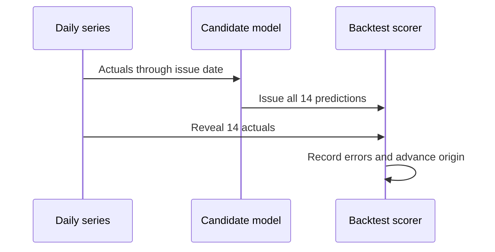

# ForecastOps walkthrough

## The forecasting problem

ForecastOps estimates daily bike rental count for 1–14 days after a **historical** cutoff, 2012-10-22. A baseline gives a simple point of comparison: seasonal naive repeats the count from the same weekday one week earlier. A more complex model is useful only if it improves errors in a fair backtest. No claim here concerns current bike demand.

A 14-day forecast is issued all at once. Once the first day is predicted, a recursive method uses that **prediction**, not the still-unknown actual, to construct later days. Chronological backtesting repeats this process at past issue dates. If a forecast accidentally uses actuals from its own future window, its reported error would be too optimistic; that is target leakage.

## Read the repository in order

1. [Experiment contract](docs/experiment_contract.md): dates, windows, parameters, and selection rule fixed before test evaluation.
2. [`forecastops/data/validation.py`](forecastops/data/validation.py): reject wrong dates, gaps, duplicates, and invalid counts. [`loader.py`](forecastops/data/loader.py) reads the raw and processed series.
3. [`forecastops/features/build.py`](forecastops/features/build.py): `one_row` makes a target-date feature row from history ending the prior day; `training_matrix` excludes the first 28 days.
4. [`forecastops/models/`](forecastops/models/): `baselines.py` supplies seasonal and last-value forecasts; `statistical.py` fits Holt-Winters; `regression.py` fits Ridge or gradient boosting and recurses with predictions. `registry.py` fixes candidate names and parameters.
5. [`forecastops/evaluation/backtest.py`](forecastops/evaluation/backtest.py): `backtest` issues a full fold before joining its actuals. `metrics.py` scores errors; `selection.py` applies the validation gate.
6. [`reports/selection.json`](reports/selection.json): frozen model identity and validation file checksums.
7. [`forecastops/monitoring/`](forecastops/monitoring/): daily replay, SQLite schema, and 28-day calculations.
8. [`forecastops/api/`](forecastops/api/): loads the release, validates requests, and serves the dashboard in [`web/`](web/index.html).

## From data to the selected model

The supplied `day.csv` has 731 days, 2011-01-01 through 2012-12-31. `scripts.prepare_data` keeps only date and total count. The initial 591 days end 2012-08-13. Five validation windows cover the next 70 days; five test windows cover the final 70 days. For example, the first validation origin is 2012-08-13: each candidate fits on dates through that day and forecasts 2012-08-14 through 2012-08-27 without seeing their counts. Those counts become available before the second origin.



`run_validation` writes 70 predictions per candidate. `select_and_test` first calls `choose` on validation metrics, writes `selection.json`, and **then** loads the full series for the held-out test. It keeps Holt-Winters because validation MAE was **793.46**, a **17.52%** reduction from seasonal naive's **962.06**, exceeding the 1% gate. On held-out test, Holt-Winters MAE was **1349.46** versus seasonal naive's **1497.66**. Ridge's test MAE was **1255.47**, but it was not the validation winner. Changing the selected model now would use the test set for tuning.

`reports/validation_fold_metrics.csv` and `test_fold_metrics.csv` contain each origin's results. `horizon_errors.csv` holds each forecast step and days 1–7 versus 8–14. WAPE is undefined if the sum of actual counts is zero; the code returns `None` rather than dividing by zero.

## One `/predict` request

`POST /predict` with `{"horizon":14}` reaches `PredictRequest` in [`schemas.py`](forecastops/api/schemas.py), which accepts only an integer 1–14. The route in [`main.py`](forecastops/api/main.py) calls `load_release` and `predict` in [`service.py`](forecastops/api/service.py). `load_release` reads `artifacts/release/manifest.json` and `model.joblib`, verifies that the saved history ends on **2012-10-22**, and requires the monitoring snapshot. The already-fitted model forecasts 14 dates, **2012-10-23 through 2012-11-05**. No fit occurs in a normal request.

The real local response starts as follows; later values are produced by the persisted model:

```json
{
  "model_name": "holt_winters",
  "model_version": "v1-20121022",
  "mode": "historical_demo",
  "trained_through": "2012-10-22",
  "horizon": 14,
  "forecast_start": "2012-10-23",
  "forecast_end": "2012-11-05",
  "predictions": [
    {"date": "2012-10-23", "value": 6998.057787694276},
    {"date": "2012-10-24", "value": 7244.649288573224}
  ],
  "disclaimer": "Historical demonstration; not a forecast for the current date."
}
```

The excerpt shows two of the actual fourteen prediction objects. It is intentionally not presented as the complete response. `horizon=0`, `15`, fractions, strings, booleans, and extra fields return HTTP 422. `/health` returns 503 when required release files are missing.

## The separate monitoring experiment

[`monitoring/replay.py`](forecastops/monitoring/replay.py) loops over each test date. It fits the frozen selected **model type** and seasonal naive on actuals through yesterday, records their one-day predictions in `forecast_issues`, then reveals today's count in `actuals`. A `monitoring_runs` row records replay status and provenance. Unique issue keys and insert-or-ignore make reruns idempotent: 140 forecast issue rows (70 per model/version) and 70 actual rows remain after a repeat run.

[`monitoring/metrics.py`](forecastops/monitoring/metrics.py) pairs errors by target date. Rolling 28-day MAE first appears on replay day 28. A nonbaseline model gets a relative deterioration flag when its rolling MAE exceeds 1.20 times the baseline's, provided baseline MAE is positive. When the selected model is seasonal naive, the replay uses a later full 28-day window against its initial 28-day window for an absolute drift flag. If a reference MAE is zero, the relative flag stays false.

This **70-origin one-step replay** measures a daily-refit policy. The five test windows measure **14-step forecasts**. The API uses one **fixed** artifact trained through 2012-10-22; it does not refit daily. `/monitoring` reads the writable SQLite copy seeded from `artifacts/monitoring_seed.sqlite`, with historical replay labels.

## Run and debug

From PowerShell, with Python 3.13:

```powershell
py -3.13 -m venv .venv
.\.venv\Scripts\python.exe -m pip install -r requirements.txt
.\.venv\Scripts\python.exe -m pip install -e . --no-deps
.\.venv\Scripts\python.exe -m scripts.prepare_data
.\.venv\Scripts\python.exe -m scripts.run_validation
.\.venv\Scripts\python.exe -m scripts.select_and_test
.\.venv\Scripts\python.exe -m scripts.build_serving_artifact
.\.venv\Scripts\python.exe -m scripts.replay_monitoring
.\.venv\Scripts\python.exe -m pytest -q
.\.venv\Scripts\python.exe -m uvicorn forecastops.api.main:app --host 127.0.0.1 --port 8000
```

If preparation fails, inspect `day.csv` dates/counts and `reports/data_manifest.json`; missing days are never interpolated. If validation fails, inspect `validation_failures.csv` by model/fold. If selection refuses to proceed, validation file checksums differ from the frozen record; do not use test results to resolve that. If `/health` fails, check the model manifest, joblib file, monitoring seed, and report. If the runtime SQLite copy is missing, `/health` copies the seed. Tests cover data contracts, past-only features, future-target mutations, folds, selection, replay idempotency, and API contracts.

Docker packaging uses pinned requirements and copies prebuilt artifacts. Docker was absent on this development machine, so container smoke checks remain pending. A Render deployment is also pending a GitHub remote and Render service access. Any runtime SQLite changes on an ephemeral host should be treated as temporary; the seed restores a historical snapshot.

## Terms

- **Origin / issue date:** last date whose actual count is known when a forecast is issued.
- **Horizon step:** how many days after the origin a target falls.
- **MAE:** average absolute difference between actual and predicted counts.
- **RMSE:** square root of average squared error; gives large misses extra weight.
- **WAPE:** total absolute error divided by total absolute actual demand, in percent.
- **Leakage:** information from a target's future entering its forecast.
- **Artifact:** saved fitted model, bounded history, and metadata used by the API.

## Exercises

1. Send `{"horizon":1}` to `/predict`. Expect one prediction dated **2012-10-23**.
2. Send `{"horizon":15}`. Expect **422** with a validation detail.
3. Inspect `reports/selection.json` and compare its validation MAE with `model_comparison.csv`. Expect Holt-Winters at about **793.46**.
4. Inspect the first 27 `records` in `monitoring_summary.json`. Expect `selected_rolling_28_mae` to be null until day 28.

## Plan versus implementation

| Plan | Actual | Reason |
|---|---|---|
| Python 3.12 | Python 3.13 locally and in Dockerfile | Only 3.13 was available on the host; pinned environment matches measured artifacts. |
| Download UCI archive | Use supplied original UCI `day.csv` | Source file already existed and its checksum is recorded. |
| Docker smoke test | Pending | Docker executable unavailable. |
| GitHub and Render deployment | Pending | No repository/remote or Render service was present. |
| Dashboard and screenshots | Local dashboard and three screenshots in `output/playwright/` | Browser verified with real report and API data. |
